# Cursor Reticle

A cursor addon for **Azeroth Survivors**: circles, a dot or crosshair, your health and a spell's
cooldown, drawn around the cursor so you never lose it in a fight.

<table>
  <tr>
    <td align="center">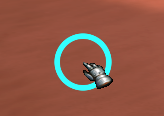 Main circle</td>
    <td align="center">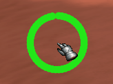 Health circle, colored by health</td>
    <td align="center">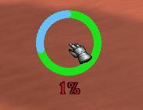 Shield and health % text</td>
  </tr>
  <tr>
    <td align="center">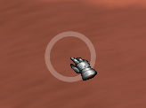 Cooldown sweep</td>
    <td align="center">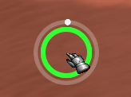 Sweep with the main circle</td>
    <td align="center">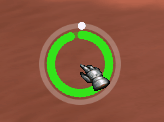 Sweep with the health circle</td>
  </tr>
  <tr>
    <td align="center">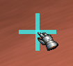 Crosshair</td>
    <td align="center">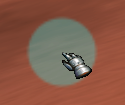 See-through dot</td>
    <td></td>
  </tr>
</table>

## Features

- **Main circle** around the cursor, with its own size, thickness, opacity, color and outline.
- **Center dot or crosshair**, with size, thickness, opacity and color, or colored by health.
- **Health circle** that fills with your health, in one color or green to red as health drops,
  with your absorb shield shown over the end of the fill.
- **Cooldown sweep** that fills as a chosen spell recharges. The main circle or the health
  circle can sit inside or outside it.
- **Low health warning** that recolors the circles, the dot or crosshair, or makes them pulse.
- **Text at the cursor**: health %, shield and seconds left on the tracked spell, in your
  choice of font.
- **Previews** for the health circle, cooldown sweep and low health warning, so you can
  set them up outside a run.
- **Saved cursors**: save your setups under a name, each shown with a small preview, switch
  between them, and share them with other players as a short code.

Every part can be turned on or off. Each tab of the options window can be reset to its
defaults on its own, or everything at once with **Reset all**.

## Installation

1. Download `CursorReticle.zip` from the [latest release](../../releases/latest). Take that
   zip, not the "Source code" downloads.
2. Install it:
   - **Windows / Linux:** extract the zip into `benilla-config/AddOns/` next to the game's
     executable, so you get `AddOns/CursorReticle/`.
   - **Browser:** in the game, open **Options → AddOns** and install the zip.
3. The addon loads the next time you enter the world.

## Usage

| Command | What it does |
|---|---|
| `/cr` or `/creticle` | Open or close the options window |
| `/cr on` / `/cr off` / `/cr toggle` | Turn the addon on or off |
| `/cr reset` | Reset every setting to its default |

The cooldown sweep's spell list shows the spells you've had in a run on your current class.
A spell stays in the list for later runs once you've had it.

## Options

Click a screenshot to see it full size.

<table>
  <tr>
    <td align="center"><a href="screenshots/01_settings_circle.png">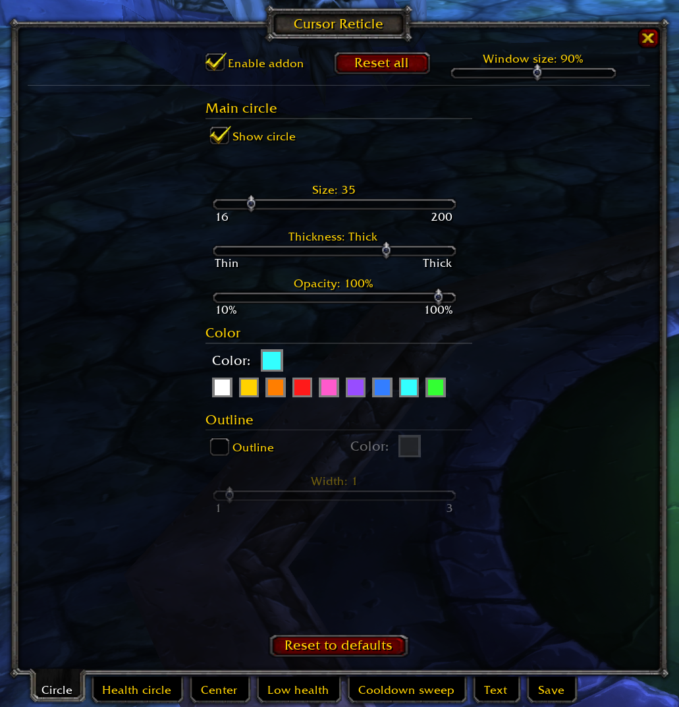</a> Circle</td>
    <td align="center"><a href="screenshots/02_settings_health-circle.png">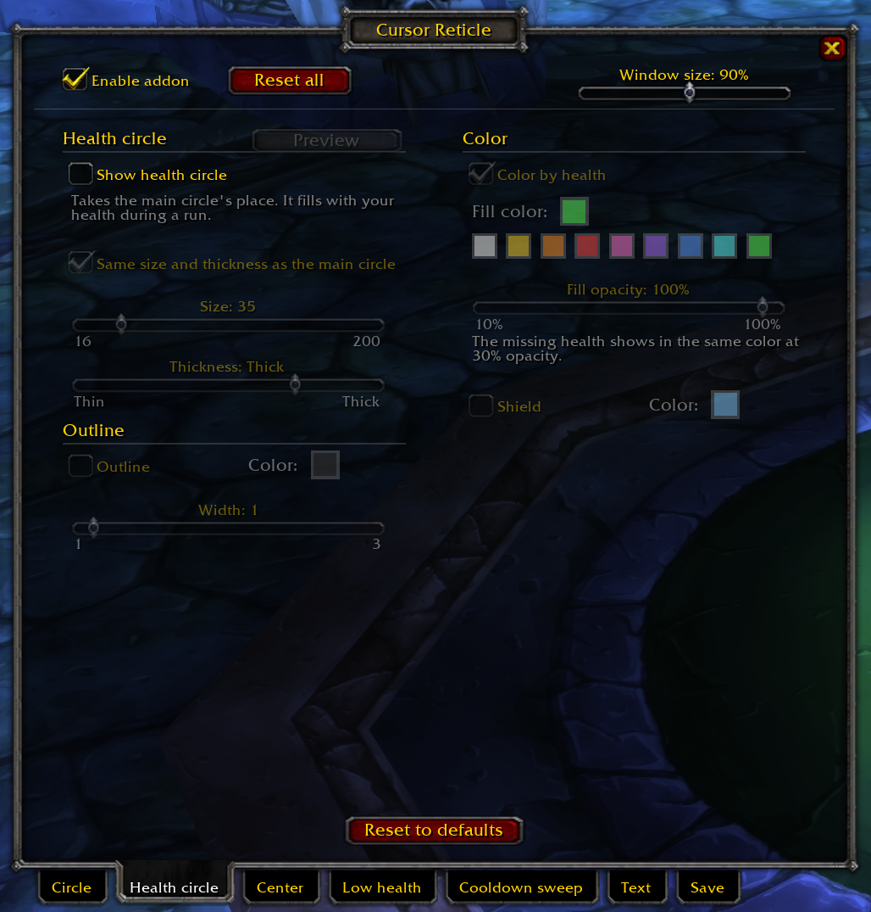</a> Health circle</td>
  </tr>
  <tr>
    <td align="center"><a href="screenshots/03_settings_center.png">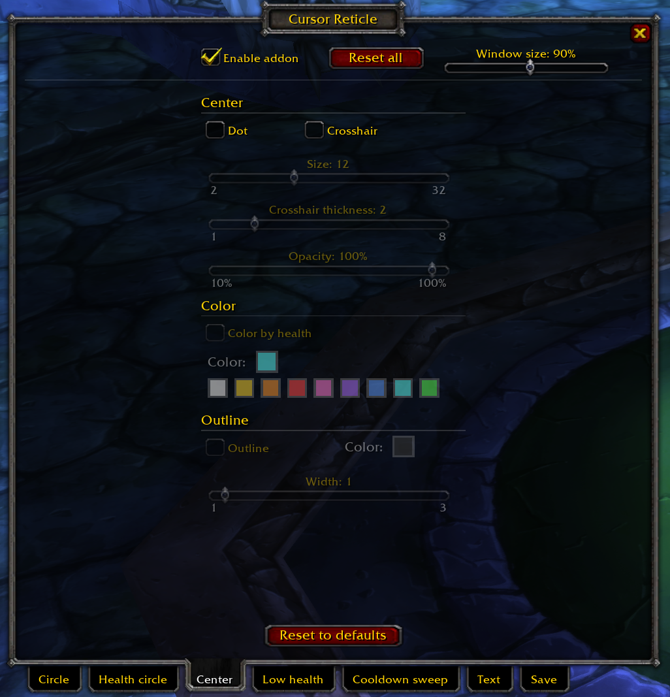</a> Center</td>
    <td align="center"><a href="screenshots/04_settings_low-health.png">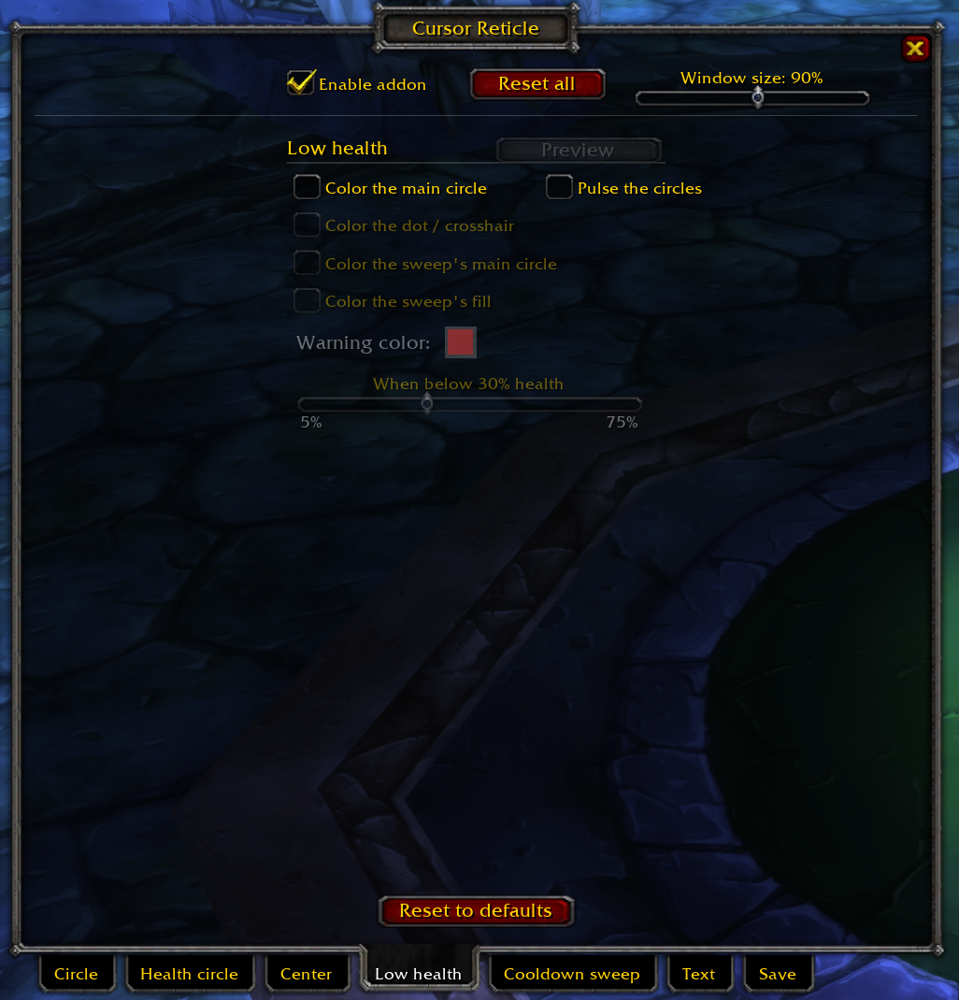</a> Low health</td>
  </tr>
  <tr>
    <td align="center"><a href="screenshots/05_settings_cooldown-sweep.png">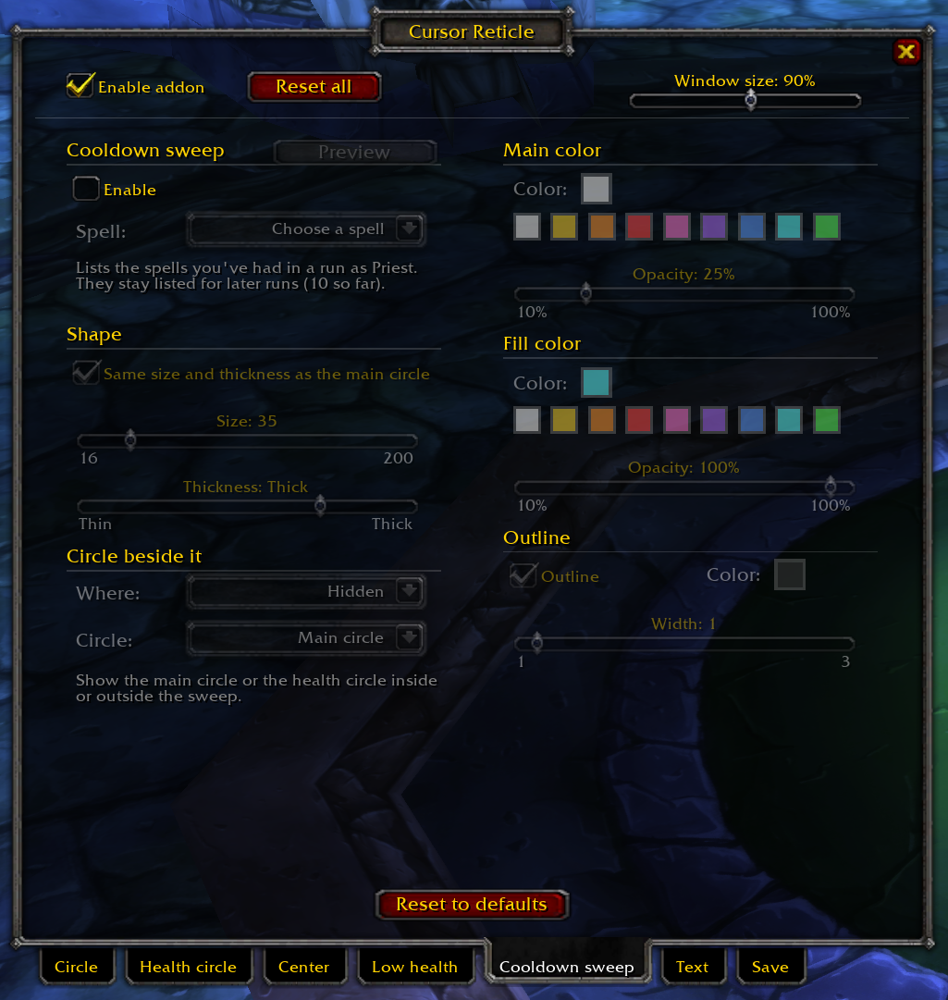</a> Cooldown sweep</td>
    <td align="center"><a href="screenshots/06_settings_text.png">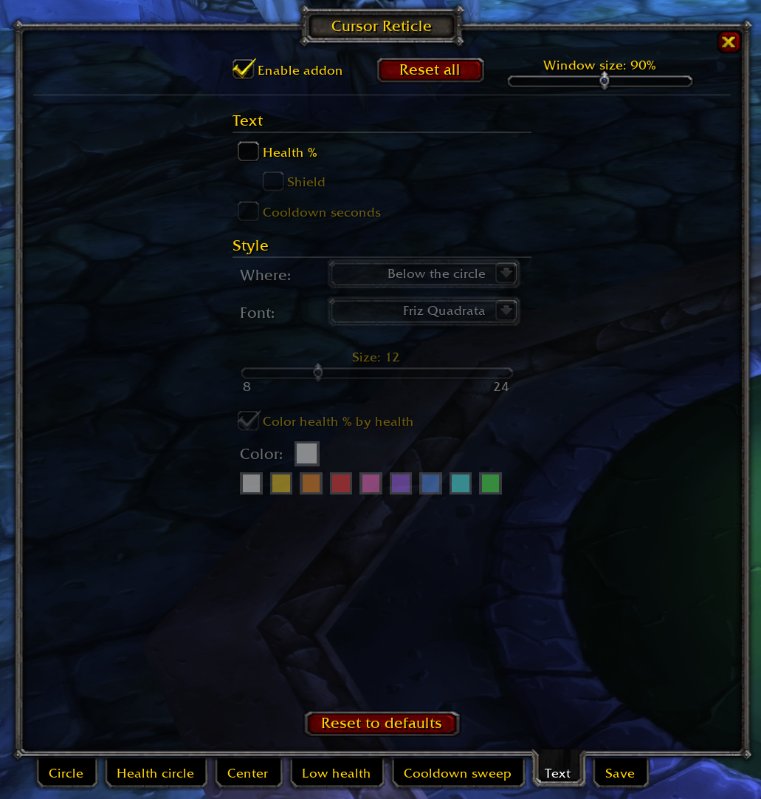</a> Text</td>
  </tr>
  <tr>
    <td align="center"><a href="screenshots/07_settings_save.png">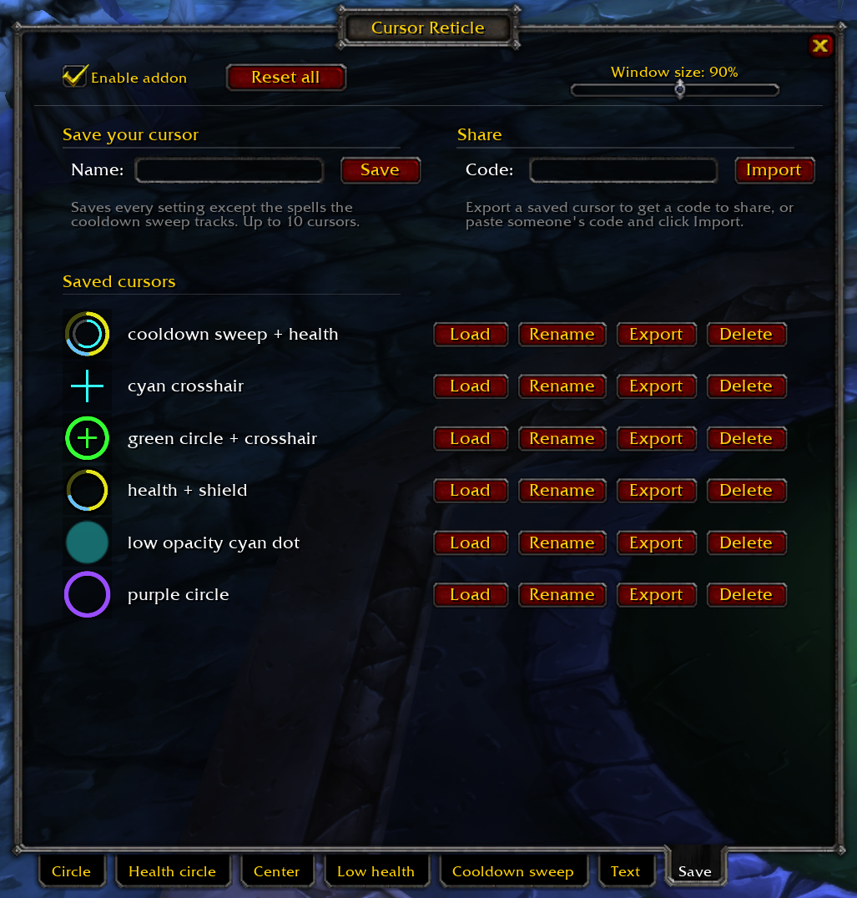</a> Save</td>
    <td></td>
  </tr>
</table>

## License

[MIT](LICENSE)
